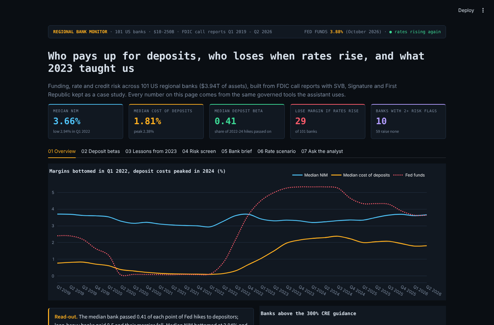
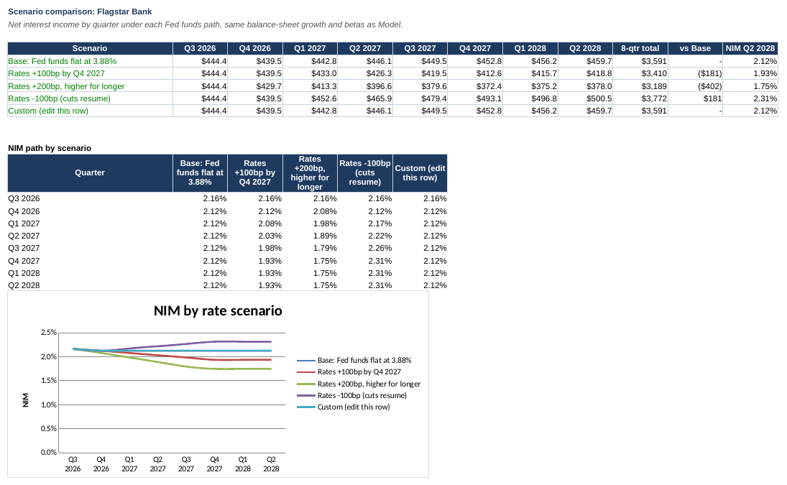
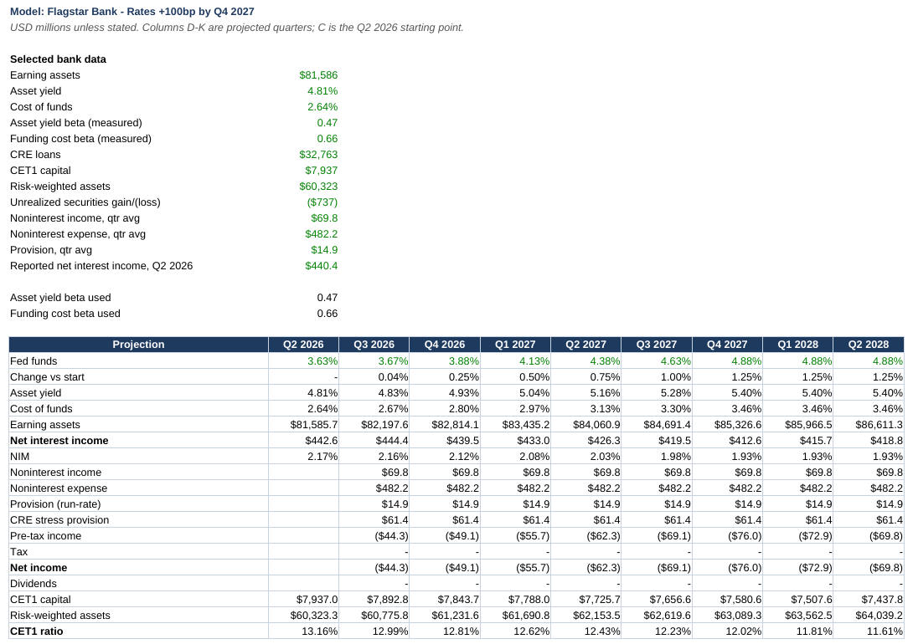
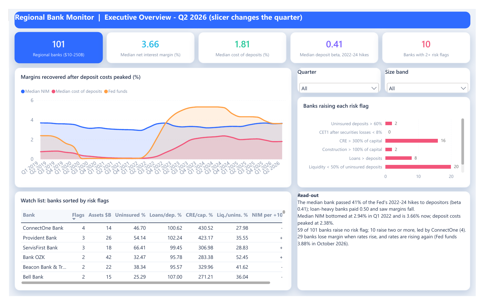
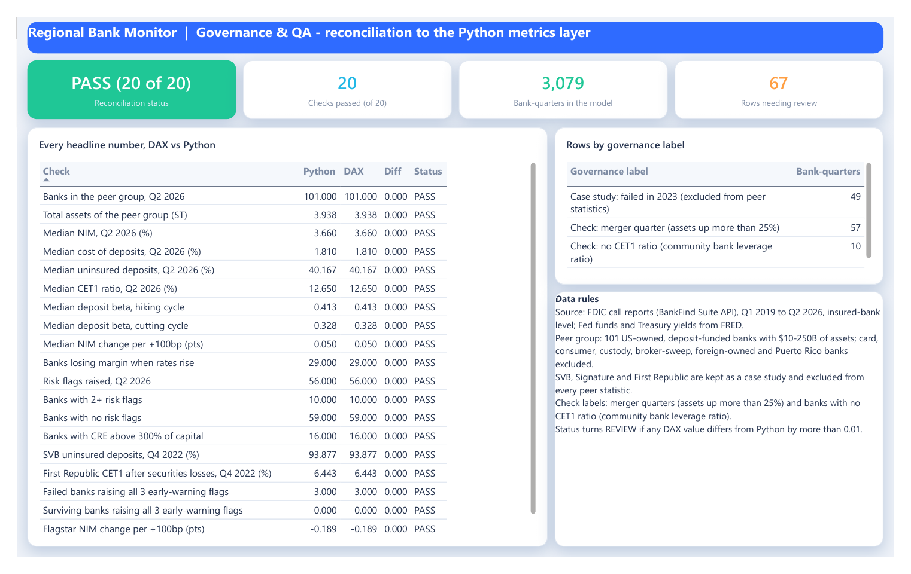
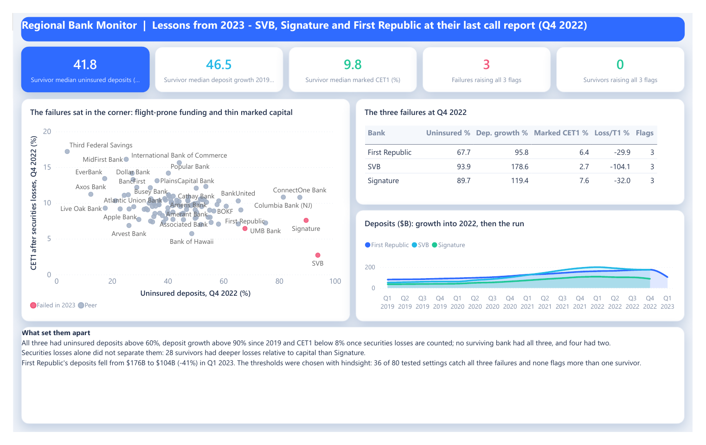
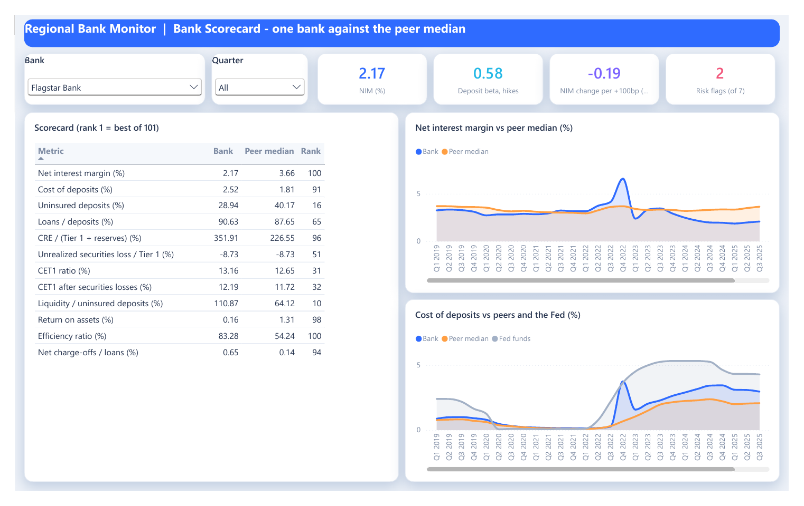
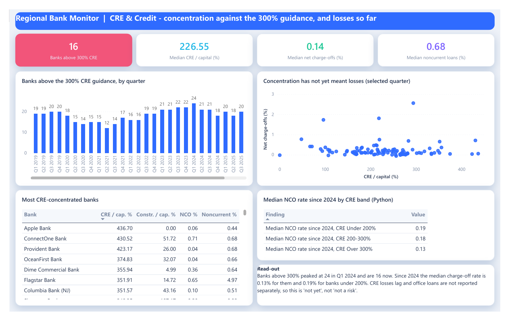
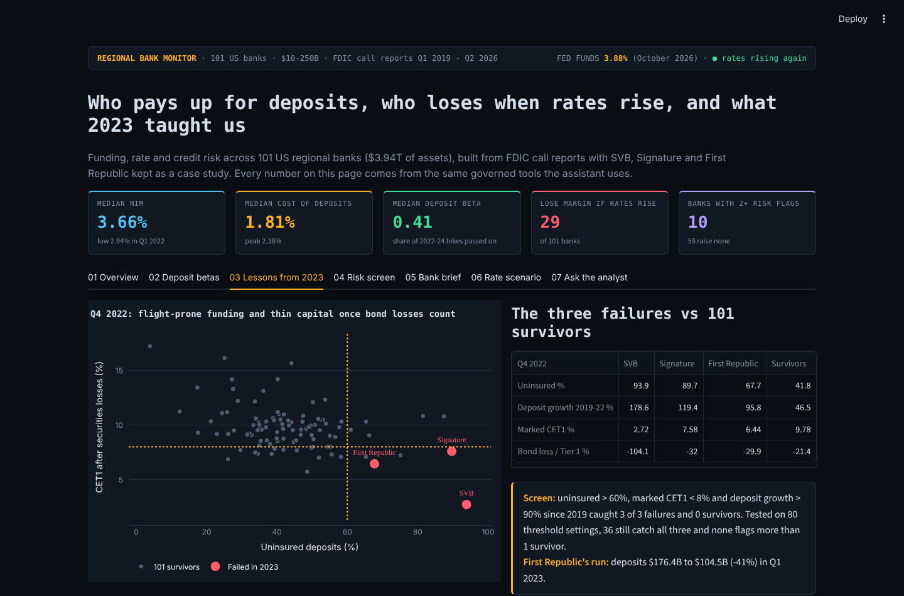
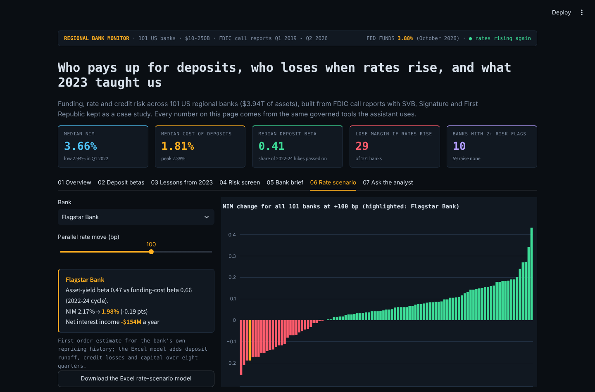

# Regional Bank Monitor

[](https://tanzil-regional-banks.streamlit.app/)
[](https://github.com/Tanzil-Ali-Rizvi/regional-bank-monitor/actions/workflows/ci.yml)


**Who pays up for deposits, who loses when rates rise, and what did 2023 teach us?** This project analyses funding, rate
and credit risk across 101 US regional banks with $10-250B of assets ($3.94 trillion in total). It uses FDIC call reports
from Q1 2019 to Q2 2026, with Silicon Valley Bank, Signature and First Republic kept as a case study. It covers:

- deposit betas through the 2022-24 hiking cycle, and what drove them;
- the 2023 failures against 101 survivors, with an early-warning screen;
- a seven-flag risk screen and commercial real estate concentration today;
- rate exposure now that the Fed is hiking again;
- an **Excel rate-scenario model**, a **Power BI report** and an assistant that answers only from the data.

**Live demo:** [tanzil-regional-banks.streamlit.app](https://tanzil-regional-banks.streamlit.app/) · **Memo:** [docs/findings.md](docs/findings.md)



## What problem this solves

**The problem.** In March 2023 three US banks failed in eight weeks. Afterwards, analysts, treasurers and supervisors all
asked the same questions: which banks rely on flight-prone deposits, which ones lose margin when rates move, and would
anyone have seen it coming? The data to answer them is public, in quarterly FDIC call reports, but it is raw: thousands of
line items per bank, with no peer group, no betas and no screen. Rates are rising again in late 2026, so the questions
are live once more.

**What this project does about it.**

- **Builds a clean, comparable peer group** from the FDIC BankFind API: 3,079 bank-quarters for 104 banks. Card lenders,
  custody banks, broker-sweep banks, foreign-owned banks and Puerto Rico banks are excluded, and the reasons are listed
  in [data/README.md](data/README.md).
- **Measures each bank's behaviour in the last cycle:** deposit beta, asset-yield beta, funding-cost beta and the
  resulting margin change per +100bp.
- **Tests what separated the 2023 failures** from the survivors at their last call report, then stress-tests the screen's
  thresholds (80 settings) so it isn't a hindsight fit.
- **Screens every bank today** on seven explainable flags, from uninsured deposits to CRE concentration and liquidity.
- **Projects eight quarters in Excel** under five Fed paths: net interest income, NIM, CRE losses and capital, for any
  bank, with every formula live.

**Who it is for:** bank treasury and ALCO teams, credit and equity analysts covering banks, bank examiners and risk teams,
and FP&A teams at banks benchmarking against peers.

**Questions it answers**

| Question | Answer from the data |
| --- | --- |
| How much of the Fed's hikes did banks pass to depositors? | 41% at the median (deposit beta 0.41; middle half 0.33 to 0.51); 0.33 on the way down |
| What drove deposit costs? | Funding need: betas rise with loans/deposits (rho 0.62) and brokered deposits (0.63), fall with securities (-0.56). Uninsured deposits did not matter (rho 0.09, p = 0.39) |
| Could the 2023 failures have been spotted? | As a combination, yes: uninsured > 60%, deposit growth > 90% since 2019 and marked CET1 < 8% caught 3 of 3 failures and 0 of 101 survivors |
| Were bond losses the tell? | Not on their own: 28 survivors had deeper securities losses relative to capital than Signature |
| Which banks look riskiest today? | ConnectOne (4 of 7 flags), Provident and ServisFirst (3 each); 59 banks raise none |
| Who loses if rates keep rising? | 29 banks. Bell Bank is most exposed (-0.26 points of NIM per +100bp); Flagstar has the largest dollar hit (-$154M a year) |
| Is CRE a problem? | 16 banks are above the 300% guidance (24 at the Q1 2024 peak); so far their charge-offs are lower, 0.13% vs 0.19% |
| What happens to one bank under a rate shock? | Pick it in the Excel model or the app: Flagstar's NIM falls from 2.17% to 1.93% under +100bp, -$181M of net interest income over 8 quarters |

## The answer in 30 seconds

| Finding | Evidence |
| --- | --- |
| **Funding need set deposit costs** | Loan-heavy third: beta 0.50, NIM -0.05 points over the cycle. Deposit-rich third: beta 0.31, NIM +0.35 |
| **2023 failures showed up only as a combination** | SVB 94% uninsured, 179% deposit growth, 2.7% marked CET1; survivor medians 42%, 46%, 9.8% |
| **Today's screen is mostly clean** | 10 banks with 2+ flags; none with uninsured > 60% and marked CET1 < 8% together |
| **Rate risk is back** | Fed funds 3.88% in October 2026, up from 3.63%; 29 banks' margins shrink as rates rise |

**Recommendation:** monitor uninsured deposits together with deposit growth and marked capital, not on their own, and
price deposits by funding need. Full memo: [docs/findings.md](docs/findings.md).

## For analyst reviewers: the finance and BI work

- **Bank financial analysis from regulatory filings**:
  - NIM, cost of deposits, CET1, Tier 1 leverage, efficiency, charge-offs and noncurrent loans;
  - CRE and construction concentration against interagency guidance;
  - CET1 marked for unrealized securities losses (AFS and HTM, after tax);
  - uninsured-deposit coverage by cash and securities.
- **Cycle analysis**: deposit, asset-yield and funding betas over Q4 2021 to Q2 2024 (Fed funds 0.08% to 5.33%), and over
  the cutting cycle to Q2 2026.
- **Statistics**: Spearman rank correlations, terciles, percentile ranks and an 80-setting robustness grid.
- **Definitions in writing**: [docs/kpi_definitions.md](docs/kpi_definitions.md) gives the call-report fields and formula
  for every ratio.

### Excel rate-scenario model

[`excel/Regional_Bank_Rate_Scenario_Model.xlsx`](excel/) is an eight-quarter projection for any of the 101 banks:

- **Seven sheets:** Cover, Inputs, Model, Scenarios, Peer_Screen, Checks and Bank_Data.
- **Live formulas.** It has 1,644 of them and no hard-coded results. Change the bank or the Fed path on Inputs and
  everything recalculates.
- **Colour-coded inputs.** Blue cells are inputs, black are formulas, green are links to other sheets.
- **Five Fed paths:** flat, +100bp, +200bp higher-for-longer, -100bp, and a custom row.
- **What it projects:** asset yields and funding costs reprice with the bank's own measured betas. It also covers a CRE
  loss stress, net income, and CET1 after dividends.
- **Self-checks:** 8 PASS checks tie the model back to the reported figures.

| Scenario comparison (Flagstar Bank) | Projection |
|---|---|
|  |  |

### Power BI report

A nine-page report in a light card theme:

- **Pages:** Executive Overview, Governance & QA, Funding & Deposit Betas, Lessons from 2023, Bank Scorecard, CRE &
  Credit, Cohort Analysis, How This Dashboard Works and Model Guide.
- **Model as code.** [`powerbi/build_pbip.py`](powerbi/build_pbip.py) generates the whole Power BI project: the TMDL
  semantic model, Power Query, 160 DAX measures in numbered folders, and nine report pages as PBIR.
- **Governed data flow.** Data runs source → staging → a Quarterly fact table that holds the business logic: average
  balances, marked capital, and a governance label with a Needs Review flag for merger quarters.
- **Quarter-scoped DAX.** Peer medians use `MEDIANX` over the 101 banks, with the failed banks excluded, alongside betas,
  the seven-flag screen and a twelve-metric scorecard with ranks.
- **Reconciled.** The Governance & QA page checks 20 headline figures, DAX against Python. **All 20 pass.**

The saved file is [`powerbi/Regional Bank Monitor.pbix`](powerbi/), with the data frozen inside so it opens anywhere.
A [PDF export](powerbi/Regional%20Bank%20Monitor.pdf) is next to it.



| Governance & QA: 20 of 20 PASS | Lessons from 2023 |
|---|---|
|  |  |
| **Bank Scorecard (Flagstar)** | **CRE & Credit** |
|  |  |

### Streamlit app

Try it live: [tanzil-regional-banks.streamlit.app](https://tanzil-regional-banks.streamlit.app/). It has seven tabs:

- Overview
- Deposit betas
- Lessons from 2023
- Risk screen
- Bank brief, a one-page note for any bank
- Rate scenario, with a slider from -200 to +300bp
- Ask the analyst

| Lessons from 2023 | Rate scenario |
| --- | --- |
|  |  |

## For AI engineering reviewers: the grounded bank analyst assistant

Example questions: *"Could SVB happen again?"*, *"Which banks pay the most for deposits?"*, *"How exposed is Bell Bank to
rising rates?"*, *"How does Zions compare with KeyBank and Western Alliance?"*

- **Ten typed tools** with OpenAI function schemas over the governed metrics:
  - peer overview
  - bank profile
  - compare banks
  - rank banks
  - deposit betas
  - lessons from 2023
  - risk screen
  - CRE & credit
  - rate exposure
  - bank trend
- **Entity resolution.** It recognises 104 banks by name or short form ("Flagstar", "M&T", "SVB", "Columbia Bank (NJ)").
  It keeps "First Citizens" apart from "Citizens Bank" and "East West" apart from "Eastern". "KeyBank" matches, but "the
  key lessons" does not. It also resolves metrics, size bands and direction: "pays the most for deposits" means the
  highest cost, which is the weakest.
- **Two modes, same facts.** In offline mode, a deterministic planner chooses the tools. With an OpenAI-compatible model,
  the model chooses them through function calling.
- **Grounding check with fallback.** If an answer contains a number that the tools did not return, the assistant falls
  back to the template answer. The one-page bank brief is held to the same check for all 101 banks.

**Evaluation, gated in CI:**

| Check | Result | Gate |
| --- | --- | --- |
| Tool selection, build set | 41/41 | 95% |
| Tool selection, held-out set (never tuned on) | 19/22 | reported |
| Answers and all 101 bank briefs grounded in tool results | 164/164 | 100% |
| Tampered answers caught (every number altered) | 1,477/1,477 | 100% |
| Claims: betas rise with loans/deposits; the 2023 screen catches 3 of 3 failures and 0 survivors; uninsured deposits do not predict betas | rho 0.62 (p = 3e-12); 3 and 0; p = 0.38 | p < 0.001; 3 and 0; p > 0.05 |

**Known limits, left visible.** The three held-out misses are in [evals/results.md](evals/results.md) and are left unfixed
so the held-out score stays honest:

- Huntington isn't recognised, so the comparison falls back to a single-bank profile.
- "Weakest liquidity against uninsured deposits" is read as uninsured share.
- "Biggest unrealized losses" ranks in the wrong direction.

Separately, 216 alterations that swapped one number for another value already in the tool results were skipped, because
number matching cannot detect them.

## Run it

```bash
git clone https://github.com/Tanzil-Ali-Rizvi/regional-bank-monitor
cd regional-bank-monitor
pip install -r requirements-dev.txt
streamlit run app/streamlit_app.py       # dashboard + assistant, offline
pytest -q && python evals/run_evals.py   # 36 tests, gated evals
python scripts/build_excel.py            # rebuild the Excel model (then recalculate in Excel or LibreOffice)
python scripts/export_powerbi.py         # governed tables + Python reference values for Power BI
python powerbi/build_pbip.py --data-dir "C:/path/to/powerbi/data/"   # generate the Power BI project
```

Optional: copy `.env.example` to `.env` and set `LLM_BASE_URL`, `LLM_API_KEY` and `LLM_MODEL`. A model will then choose the tools.

## Repository layout

```
data/raw/        FDIC call reports (financials, institutions) and FRED rates, with data/README.md (peer group rules)
src/bankmon/     data (panel, ratios, peer group), metrics (betas, 2023 screen, risk flags, CRE, rate exposure), tools, assistant
app/             Streamlit app (dark terminal theme)
excel/           eight-quarter rate-scenario model (1,644 live formulas, 8 checks)
powerbi/         PBIP generator (TMDL model + PBIR report), exported data, the .pbix and PDF
evals/           tool-selection sets (build + held-out), grounding, tamper, statistical claim gate
tests/           36 tests: ratio identities, betas, 2023 screen, Excel formulas and checks, assistant, memo numbers
docs/            findings memo, KPI definitions, screenshots
scripts/         Excel builder, Power BI export
```

## Data and caveats

- **Source:** FDIC BankFind Suite (call reports) and FRED, both public US government data, retrieved 24 November 2026.
- **Bank level, not the holding company.** Parent debt and parent liquidity are not covered.
- **Mergers are included** in deposit growth and betas. Quarters where assets jump by more than 25% are labelled rather
  than removed.
- **Rate sensitivity is first-order and backward-looking.** It assumes the next cycle repeats each bank's last one.
- **The 2023 screen rests on three failures**, a small sample. Treat it as a pattern, not a validated model.
- **Office CRE is not reported separately** in the call report, so CRE credit risk is measured on the whole
  non-owner-occupied book.
- **Not investment advice.** A risk flag is a prompt to look closer, not a verdict.

## License

MIT. Built by [Tanzil Ali Rizvi](https://github.com/Tanzil-Ali-Rizvi).
